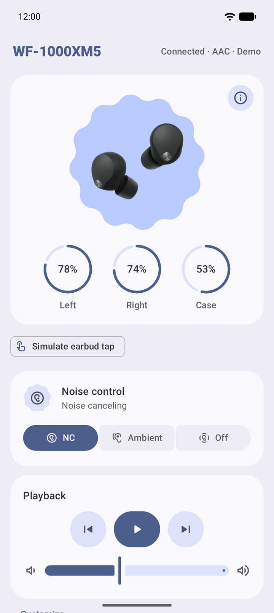
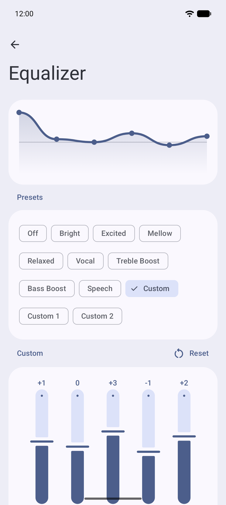
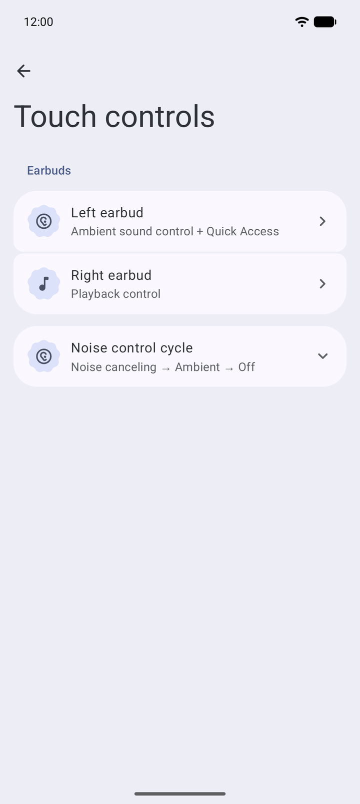
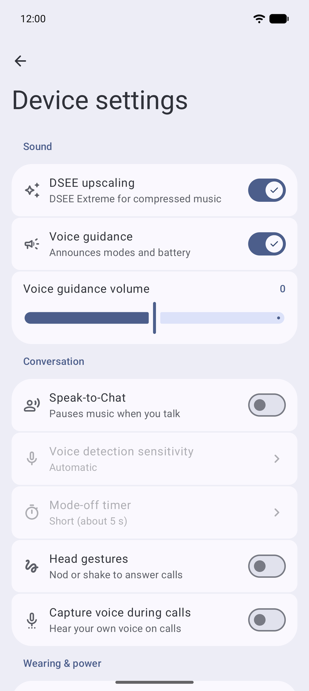

<p align="center">
  
</p>

<h1 align="center">LibreCans</h1>

LibreCans is an independent Android app for Sony headphones, written in Kotlin with Jetpack Compose
and Material 3 Expressive. It talks to the headphones directly over Bluetooth: no account, no
cloud, no tracking. It is developed and tested with the **WF-1000XM5** and works with other Sony
headphones that use the MDR v2 protocol (WH-1000XM5, WF-1000XM4, LinkBuds S, WH-CH720N and more).

<p align="center">
  
  
  
  
</p>

## Features

* **Noise control**: noise canceling, ambient sound with 20 levels and Focus on Voice.
* **Touch controls**: choose what each earbud does (ambient sound control, playback,
  volume, Quick Access) or turn taps off for one side, with every gesture spelled out. Pick which
  modes the ambient sound tap cycles through.
* **Equalizer**: the headphones' presets plus a custom 5-band curve with Clear Bass and a live
  response graph.
* **Batteries**: left, right and case, live while charging.
* **Playback**: play/pause, skip and volume.
* **Device settings**: DSEE, Speak-to-Chat with sensitivity and timeout, head gestures,
  pause when taken off, automatic power off, voice guidance, multipoint, capture voice during calls,
  remote power off.
* **Capability aware**: only controls the headphones report are shown.
* **Background connection**: an ongoing notification with battery and a noise mode
  shortcut, reconnecting when the headphones come back.
* **Private**: settings are AES-GCM encrypted with an Android Keystore key and excluded from
  backups; the optional protocol log lives in memory only.

## Project layout

```
protocol/   Pure Kotlin MDR library: framing, requests, decoders, session, client, simulator
app/        Android app
baselineprofile/  Baseline Profile generator and macrobenchmarks
  data/       Bluetooth (RFCOMM), connection repository, encrypted settings, diagnostics
  service/    Foreground connection service and notification
  ui/         One package per screen (devices, dashboard, equalizer, touch, settings, about)
docs/       Protocol notes
```

`protocol` contains `SimulatedHeadphones`, a WF-1000XM5 that speaks the real protocol. Tests use
it, and debug and benchmark builds offer it as **Demo headphones**, so the whole app can be used on an emulator.

## Building

Requirements: JDK 17 or newer (Android Studio's bundled JBR works) and the Android SDK with
platform 37.

```bash
./gradlew :app:assembleDebug          # app/build/outputs/apk/debug/app-debug.apk
./gradlew :protocol:test :app:testDebugUnitTest   # JVM and Robolectric tests
./gradlew :app:connectedDebugAndroidTest           # on a running emulator or device
./gradlew :app:lintDebug
```

Android Studio shares run configurations for these in `.run/`. `tools/emulator.sh` starts the
`LibreCans_Pixel_9_Pro_API_37` test emulator (`--headless` for no window).

## Performance

Debug builds run without R8 and mostly interpreted, so they scroll noticeably worse than what users
get. Judge smoothness on the `benchmarkRelease` variant (Build Variants in Studio): it is minified
like release, signed with the debug key, profileable, still has the demo device and installs as
`org.librecans.app.benchmark` next to a store build.

```bash
./gradlew :app:generateBaselineProfile                       # refresh app/src/release/generated/baselineProfiles
./gradlew :baselineprofile:connectedBenchmarkReleaseAndroidTest   # frame and startup timing, with and without profile
python3 tools/measure-scroll.py org.librecans.app.benchmark --runs 5  # dumpsys gfxinfo frame stats while scrolling the demo
```

On an emulator add `-Pandroid.testInstrumentationRunnerArguments.androidx.benchmark.suppressErrors=EMULATOR`
to the benchmark task.

## Credits

LibreCans builds on the reverse-engineering work of
[SonyHeadphonesClient](https://github.com/Plutoberth/SonyHeadphonesClient) (Plutoberth, Mr-M33533K5,
semvis123), its [mos9527 fork](https://github.com/mos9527/SonyHeadphonesClient),
[SonyBridge](https://github.com/AmitRajput-Dev/SonyBridge) (AmitRajput-Dev) and
[Gadgetbridge](https://codeberg.org/Freeyourgadget/Gadgetbridge). See `NOTICE.md`.

Released under the MIT License, see `LICENSE`.

*LibreCans is not affiliated with, authorized, maintained, sponsored, or endorsed by Sony
Corporation or any of its affiliates.*
